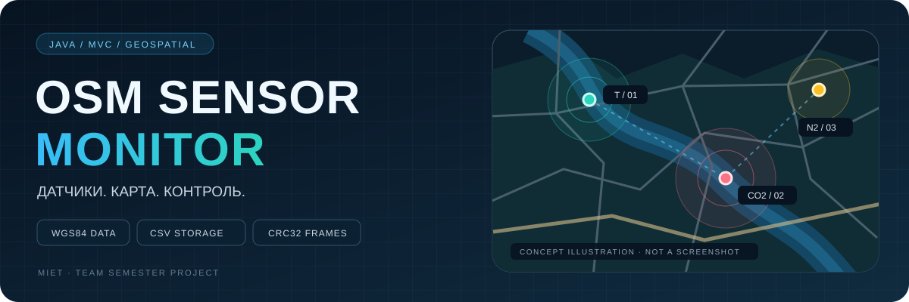
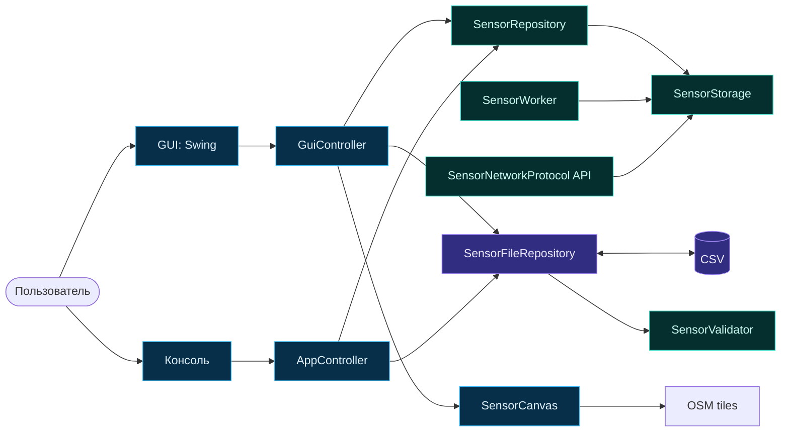
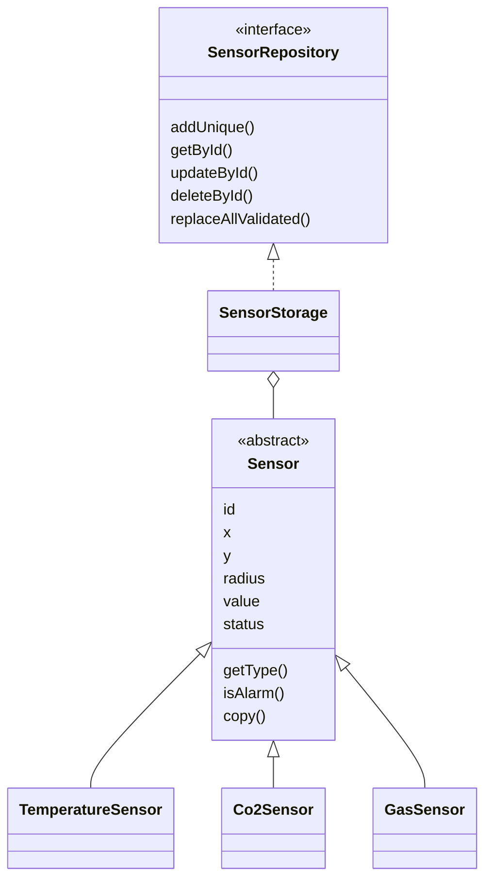
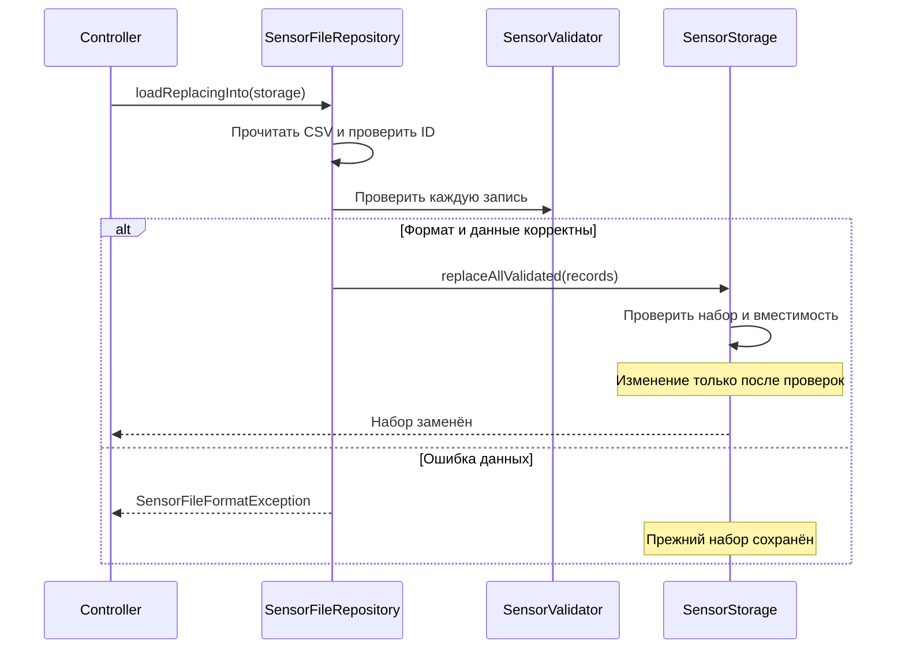

<div align="center">
  

  <h1>OSM Sensor Monitor</h1>
  <p>Датчики на карте. Проверяемые данные. Java без магии.</p>

  <p>
    
    
    
    
    
  </p>

  

  <p>
    <a href="#quickstart">Запустить</a> ·
    <a href="#features">Возможности</a> ·
    <a href="#architecture">Архитектура</a> ·
    <a href="#checks">Проверки</a> ·
    <a href="#team">Команда</a> ·
    <a href="#troubleshooting">Решение проблем</a>
  </p>
  <p>Командный семестровый проект по Java · МИЭТ · учебная разработка</p>
</div>

---

## Идея проекта

OSM Sensor Monitor — настольное приложение для работы с датчиками температуры, CO2 и N2. Оно объединяет географическую визуализацию, объектную модель, хранение в памяти и CSV, проверку данных и учебные эксперименты с коллекциями и потоками.

Проект развивается от простых классов и консольного меню к графическому приложению с картой. Каждая часть остаётся доступной для объяснения в коде: от полиморфного `isAlarm()` до атомарной замены набора датчиков.

> [!NOTE]
> Баннер — авторская иллюстрация предметной области, а не скриншот или запись работы программы. Бейджи описывают стек, а не прохождение CI. Настоящие скриншоты и запись демонстрации пока не включены.

<a id="features"></a>
## Возможности

| Направление | Что есть в текущем коде | Где искать |
| :--- | :--- | :--- |
| Карта | Онлайн-подложка OpenStreetMap, перемещение и масштабирование, датчики и круги покрытия | `view/MapLoader`, `view/SensorCanvas` |
| Графический режим | Вход, генерация 50/100/200/300 датчиков, seed, загрузка CSV, фильтр аварийных | `controller/GuiController` |
| Консольный режим | Добавление, поиск, фильтрация, редактирование, удаление, сохранение и загрузка | `controller/AppController` |
| Модель | Абстрактный датчик и три конкретных типа; собственная логика тревоги | `model/Sensor` и наследники |
| Хранилище | Уникальные ID, синхронизированные операции, копирование состояния, обновление по timestamp | `model/SensorStorage` |
| CSV | Валидация записей, поиск дубликатов, атомарная загрузка набора, сохранение через временный файл | `model/SensorFileRepository` |
| Многопоточность | Фоновый источник показаний и разрешение коллизий по времени | `model/SensorWorker`, `model/WriteResult` |
| Протокол | Сериализация пакетов, версия, ограничения размера, CRC32, проверка до применения | `model/SensorNetworkProtocol` |
| Эксперименты | Сравнение операций `ArrayList` и `LinkedList` | `model/SensorCollectionExperiment` |

> [!IMPORTANT]
> Возможности слоя Model не означают наличия соответствующей кнопки в GUI. Например, CRUD и явное сохранение доступны в консольном сценарии; сетевой протокол сам по себе не запускает сервер или клиент. Наличие реализации не заменяет проверку полного пользовательского сценария.

<a id="quickstart"></a>
## Быстрый старт

### 1. Подготовить окружение

Нужны JDK 17 или новее, Maven и Git. Для графического режима требуется настольное окружение; для OSM-подложки — доступ к интернету.

```bash
java -version
javac -version
mvn -version
```

### 2. Скачать и запустить

```bash
git clone https://github.com/salatekk4/osm-sensor-monitor-.git
cd osm-sensor-monitor-
mvn compile exec:java -Dexec.mainClass=ru.miet.osmsensors.Main
```

В названии репозитория и папки есть завершающий дефис: `osm-sensor-monitor-`.

После запуска введите логин и пароль из своего локального `config.properties`. Команду запуска выполняйте из корня проекта: приложение ищет настройки относительно текущей рабочей папки.

<details>
<summary>Уже скачали проект? Повседневный запуск и обновление</summary>

Запуск из папки проекта:

```bash
mvn compile exec:java -Dexec.mainClass=ru.miet.osmsensors.Main
```

Обновление чистой рабочей копии в ветке `main`:

```bash
git pull --ff-only origin main
```

Повторно выполнять `git clone`, `git init` и `mvn clean` перед каждым запуском не нужно. Если Git сообщает о локальных изменениях, сначала разберитесь с ними: не удаляйте их ради обновления.

</details>

<details>
<summary>Запуск двойным кликом на macOS</summary>

В корне проекта создайте файл `Запустить.command` с содержимым:

```bash
#!/bin/zsh
export PATH="/opt/homebrew/bin:/usr/local/bin:$PATH"
cd -- "$(dirname -- "$0")" || exit 1
mvn compile exec:java -Dexec.mainClass=ru.miet.osmsensors.Main
if [[ $? -ne 0 ]]; then
    echo "Ошибка запуска: смотри сообщения выше."
    read -r "?Нажми Enter для выхода..."
fi
```

Один раз разрешите выполнение:

```bash
chmod u+x Запустить.command
```

Далее открывайте файл двойным кликом в Finder. Java и Maven должны быть доступны в окружении запуска; если скрипт их не находит, используйте терминал и проверьте PATH. Сам файл запуска не добавляется в проект автоматически при чтении этой инструкции.

</details>

### Режимы запуска

```bash
# Окно с картой — режим по умолчанию
mvn compile exec:java -Dexec.mainClass=ru.miet.osmsensors.Main

# Консольное меню с демонстрационным набором
mvn compile exec:java -Dexec.mainClass=ru.miet.osmsensors.Main -Dexec.args="--console --demo"

# Консоль с увеличенным лимитом
mvn compile exec:java -Dexec.mainClass=ru.miet.osmsensors.Main -Dexec.args="--console --limit 1000"

# Отдельный эксперимент с коллекциями
mvn compile exec:java -Dexec.mainClass=ru.miet.osmsensors.Main -Dexec.args="--benchmark"
```

| Аргумент | Назначение |
| :--- | :--- |
| `--gui` | Графический режим; используется и без аргументов |
| `--console` | Консольный интерфейс |
| `--demo` | Начальный демонстрационный набор для консоли |
| `--limit N` | Вместимость хранилища; по умолчанию 1000 для GUI и 20 для консоли |
| `--benchmark` | Эксперимент коллекций с выходом после вывода результатов |

## Демонстрация за две минуты

1. Запустите приложение и войдите с локальными учётными данными.
2. Оставьте `Seed = 42`: набор будет воспроизводимым.
3. Измените количество датчиков и нажмите «Сгенерировать новые».
4. Полностью очистите поле seed и повторите генерацию для нового случайного набора.
5. Включите «Фильтр аварийных» и сравните число показанных датчиков со всем набором.
6. Для сохранения, редактирования и удаления воспользуйтесь консольным режимом.
7. Запустите проверки Model из раздела ниже.

Генерация заменяет текущий набор в памяти. В текущем GUI автоматическое сохранение после генерации отключено: не считайте новый набор уже записанным в CSV.

<a id="architecture"></a>
## Архитектура



Это карта основных связей, а не обещание полного разделения всех адаптеров: например, `SensorTableModel` — Swing-адаптер, который исторически находится в пакете `model`.

### Модель предметной области



| Тип | Класс | Смысл |
| :--- | :--- | :--- |
| `T` | `TemperatureSensor` | Температурный датчик |
| `CO2` | `Co2Sensor` | Датчик углекислого газа |
| `N2` | `GasSensor` | Газовый датчик учебной модели |

Тревога определяется полиморфным методом `isAlarm()`. Поле `status` с вариантами `OK`, `WARNING`, `ERROR` хранится отдельно: статус и результат проверки порога — разные характеристики.

## Данные и координаты

| Поле | Контракт |
| :--- | :--- |
| `id` | Неотрицательный идентификатор; в хранилище уникален, ноль допустим |
| `x` | Долгота WGS84 в градусах: от −180 до 180 |
| `y` | Широта WGS84 в градусах: от −90 до 90 |
| `radius` | Неотрицательный радиус в метрах |
| `value` | Конечное числовое показание |
| `type` | `T`, `CO2` или `N2` |
| `status` | `OK`, `WARNING` или `ERROR` |

Порядок координат важен: поля и CSV используют `x = longitude`, `y = latitude`, а конструктор `GeoPosition` принимает сначала широту, затем долготу.

Географические границы проверяются валидатором, CSV и проверяемыми пакетными API. Старые конструкторы, сеттеры и одиночные операции хранилища не обеспечивают полную проверку геоданных на каждом пути записи. Для новых точек входа используйте `SensorValidator`.

Географически допустимые полюса не поддерживаются обычной тайловой проекцией Web Mercator. Планарный учебный `MapViewport` не следует считать географической проекцией или использовать для смешивания градусов с метрами.

### Пример CSV

```csv
id,type,x,y,radius,value,status
1,T,37.62,55.75,1000,55.0,WARNING
2,CO2,37.64,55.76,1500,1200.0,ERROR
3,N2,37.60,55.74,800,85.0,OK
```

Это демонстрационные данные, а не реальные измерения и не нормативы безопасности. В CSV используйте точку в десятичных числах: запятая разделяет поля.

### Как защищаются данные



- `loadReplacingInto()` заменяет весь набор; `loadInto()` добавляет набор без частичной загрузки при проверяемой ошибке.
- Отсутствующий файл при замене — ошибка. Корректный пустой файл означает намеренную очистку набора.
- Перед записью CSV формируется и проверяется содержимое, затем записывается соседний временный файл и выполняется атомарная замена.
- Если файловая система не поддерживает атомарное перемещение, сохранение завершается ошибкой, без намеренного перехода к небезопасной перезаписи на месте.
- Эта схема не является гарантией сохранности при отключении питания или полноценной многопроцессной базой данных.

### Копии и многопоточность

`SensorStorage` копирует датчики при записи и выдаче. Изменение результата `getById()` или `getAll()` не меняет внутреннее состояние автоматически: сохраните изменения через `updateById()` или `upsert()`.

`upsert()` разрешает коллизии по timestamp: более старое показание отклоняется, при равном времени остаётся последнее принятое. Это не распределённые часы: для разных источников требуется согласованное время.

## Сетевой протокол: модуль, а не готовый сервер

`SensorNetworkProtocol` работает с потоками и байтовыми пакетами. Он не открывает сокеты, не управляет окном и не добавляет серверный режим в `Main`.

```text
FRAME / big endian
┌───────────────────┬─────────────────────────────────────┬─────────────┐
│ bodyLength: int   │ body: magic + version + records     │ CRC32: int  │
└───────────────────┴─────────────────────────────────────┴─────────────┘
```

| Ограничение | Значение |
| :--- | :--- |
| Версия | `1` |
| Количество записей | Не более 10 000 |
| Тело пакета | Не более 1 MiB |
| Строки | Java modified UTF-8 через `writeUTF/readUTF` |
| Контроль целостности | CRC32 тела пакета |

CRC32 обнаруживает случайное повреждение, но не является шифрованием или аутентификацией. Управление соединениями, тайм-аутами и жизненным циклом транспорта — отдельная задача интеграции.

## Конфигурация

Настройки читаются из `config.properties` в корне рабочей папки.

| Ключ | Назначение |
| :--- | :--- |
| `login` | Непустой локальный логин |
| `password` | Непустой локальный пароль |
| `group` | `user` или `root`; влияет на консольные административные пункты |
| `debug` | Диагностический режим |
| `autotests` | Запуск встроенных автотестов после входа |
| `dbfile` | Путь к CSV; значение по умолчанию — `sensors.csv` |

Локальные учётные данные предназначены для учебной демонстрации. Не используйте реальные пароли, токены или другие секреты: конфигурация не является защищённым хранилищем учётных данных.

<a id="checks"></a>
## Сборка и проверки

```bash
mvn clean compile
```

После успешной компиляции можно отдельно запускать проверочные классы:

```bash
java -cp target/classes ru.miet.osmsensors.model.ModelIntegrityCheck
java -cp target/classes ru.miet.osmsensors.model.GeoCheck
java -cp target/classes ru.miet.osmsensors.model.NetworkCheck
java -cp target/classes ru.miet.osmsensors.model.ConcurrencyCheck
java -cp target/classes ru.miet.osmsensors.model.MapCheck
```

| Проверка | Что исследует |
| :--- | :--- |
| `ModelIntegrityCheck` | Геогенерацию, воспроизводимость, копии, дубликаты, пакетные операции и CSV |
| `GeoCheck` | Диапазоны координат, нечисловые значения и порядок широты/долготы |
| `NetworkCheck` | CRC32, формат пакета, повреждения, импорт и конкурентное применение |
| `ConcurrencyCheck` | Параллельные записи и счётчики коллизий; проверьте итог в выводе |
| `MapCheck` | Учебный модуль преобразования координат; не визуальную корректность OSM-карты |

> [!IMPORTANT]
> Это отдельные исполняемые классы, а не автоматически подключённый набор JUnit. `mvn test` не заменяет эти команды. Успешная компиляция и проверки Model не подтверждают работу всех кнопок, карты и пользовательских сценариев GUI.

### Эксперимент с коллекциями

Режим `--benchmark` сравнивает операции добавления и удаления в `ArrayList` и `LinkedList` на учебных наборах разного размера. Результаты включают суммарное и среднее время операций.

Это учебный эксперимент, не универсальный рейтинг коллекций и не промышленный benchmark. Сравнивайте несколько запусков в одинаковых условиях и учитывайте JVM, прогрев и нагрузку компьютера.

## Навигация по коду

```text
.
├── pom.xml
├── config.properties
├── README.md
├── docs/
│   ├── coordinates.md          # Историческая заметка о миграции координат
│   └── assets/
│       └── hero.svg            # Иллюстрация для README
└── src/ru/miet/osmsensors/
    ├── Main.java               # Режимы запуска и связывание компонентов
    ├── controller/
    │   ├── AppController.java  # Консольные сценарии
    │   ├── GuiController.java  # Сценарии Swing
    │   ├── AppConfig.java      # Настройки
    │   └── AppLogger.java      # Логирование
    ├── model/
    │   ├── Sensor.java         # Абстрактная сущность и copy()
    │   ├── *Sensor.java        # Конкретные виды датчиков
    │   ├── SensorRepository.java
    │   ├── SensorStorage.java
    │   ├── SensorFileRepository.java
    │   ├── SensorValidator.java
    │   ├── SensorNetworkProtocol.java
    │   ├── SensorWorker.java
    │   └── *Check.java         # Проверочные классы
    └── view/
        ├── ConsoleView.java
        ├── MapLoader.java
        ├── SensorCanvas.java
        └── AutoTests.java
```

Дерево сокращено: вспомогательные классы и исключения находятся рядом со своими модулями. [Заметка о координатах](docs/coordinates.md) описывает ранний этап миграции; её исторические ограничения нужно сопоставлять с текущим кодом и контрактами выше.

<a id="team"></a>
## Команда

| Участник | Основная зона | Ответственность |
| :--- | :--- | :--- |
| [Максим · salatekk4](https://github.com/salatekk4) | Model / File I/O | Датчики, контракты, хранилище, CSV, валидация и модельные API |
| [Вика · edelshteinv](https://github.com/edelshteinv) | Controller | Сценарии приложения, запуск и подключение компонентов |
| [Игорь · skeletoneyd](https://github.com/skeletoneyd) | View / документация / сборка | Представление данных, карта, визуализация и подготовка проекта к показу |

Основные зоны помогают работать параллельно, но не исключают интеграционных правок. Изменения `Main`, общих интерфейсов и поведения чужих модулей согласуются заранее.

<details>
<summary>Что показывать на защите</summary>

| Тема | Точка входа в код |
| :--- | :--- |
| Наследование и полиморфизм | `Sensor`, наследники и вызовы `isAlarm()` |
| Контракт и реализация | `SensorRepository` → `SensorStorage` |
| Коллекции | Хранилище и `SensorCollectionExperiment` |
| Исключения | Дубликат ID, отсутствие датчика, вместимость, формат CSV |
| Файловый ввод-вывод | Проверка CSV, временный файл и замена |
| Защита состояния | `copy()` и выдача отделённых объектов |
| Графика | `SensorCanvas`, проекция карты и радиусы |
| Многопоточность | `SensorWorker`, синхронизация и `upsert()` |
| Потоковый протокол | Длина кадра, версия, CRC32 и пакетное применение |

Показывайте только реально реализованный и проверенный сценарий. Авторство конкретных изменений уточняется по истории коммитов, а не только по названию папки.

</details>

<a id="troubleshooting"></a>
## Если что-то пошло не так

<details>
<summary>Кнопка «Сгенерировать новые» не меняет картинку</summary>

При одинаковом seed и количестве генерируется тот же набор. Очистите поле seed или измените число. Проверьте фильтр аварийных, счётчик датчиков и сообщения в терминале. Само по себе отсутствие видимого изменения не доказывает сбой генератора.

</details>

<details>
<summary>Module ru.miet not found / ClassNotFoundException</summary>

Используйте точное имя класса с точками, не путь со слешем:

```bash
mvn compile exec:java -Dexec.mainClass=ru.miet.osmsensors.Main
```

Пакет называется `osmsensors`, не `asmsensors`. `compile` перед запуском собирает классы.

</details>

<details>
<summary>Не найден config.properties или не получается войти</summary>

Запускайте приложение из папки с `pom.xml` и `config.properties`. Проверьте непустые `login` и `password` в своей локальной конфигурации. Пароль не нужно отправлять в чат или добавлять в issue.

</details>

<details>
<summary>CSV, который раньше загружался, теперь отклоняется</summary>

Проверьте семь полей, уникальность ID, конечность чисел, диапазоны WGS84, неотрицательный радиус, известные типы и статусы. Старые условные координаты `0..1000` нельзя автоматически считать географическими. Сохраните исходный файл перед преобразованием.

</details>

<details>
<summary>Карта пустая, но приложение запустилось</summary>

Проверьте интернет и доступность OSM-тайлов. Переместите или уменьшите масштаб карты, проверьте наличие датчиков и фильтр аварийных. Для отчёта об ошибке приложите текст исключения, версию Java и последний коммит, но не пароли и другие секреты.

</details>

<details>
<summary>Не удаётся сохранить CSV на выбранном диске</summary>

Проверьте права записи и поддержку атомарного перемещения файлов. Репозиторий намеренно не переключается на перезапись основного файла на месте, если атомарная замена недоступна.

</details>

## Границы текущей версии

- Карта загружает онлайн-тайлы; офлайн-рендеринг PBF не заявлен.
- Хранилище содержит текущие состояния, а не постоянную историю всех измерений.
- Пользовательские постоянные слои и база данных не заявлены как готовые возможности.
- GUI не содержит всех операций консольного меню; автосохранение генерации отключено.
- Сетевой код — проверяемый API протокола; подключённый серверный режим в `Main` не заявлен.
- Локальный вход и CRC32 не заменяют безопасную аутентификацию и шифрование.
- Проект не предназначен для принятия реальных решений о промышленной или медицинской безопасности.

## Следующие шаги

- [ ] Дополнить проверки сценариями GUI и повторной генерации.
- [ ] Перевести генерацию в контроллере на атомарную замену набора.
- [ ] Подключить standalone-проверки к автоматизированному процессу сборки.
- [ ] Добавить реальные скриншоты и короткую запись демонстрации.
- [ ] Согласовать следующие функции по требованиям семестрового задания.

## Благодарности и оформление

Картографические данные: [© OpenStreetMap contributors](https://www.openstreetmap.org/copyright). Отображение карты: [JXMapViewer2](https://github.com/msteiger/jxmapviewer2). Внешние бейджи: [Shields.io](https://shields.io/). Анимированная строка: [Readme Typing SVG](https://github.com/DenverCoder1/readme-typing-svg).

Баннер хранится в самом репозитории и не загружает внешние изображения. Бейджи и анимированная строка зависят от сторонних сервисов; текстовая документация доступна и без них.

В репозитории на момент подготовки этого README нет файла `LICENSE`; лицензия не назначается оформлением документации.

---

<div align="center">
  <p>От объекта Sensor — к карте и проверяемым потокам данных.</p>
  <p><a href="#quickstart">К запуску ↑</a> · <a href="#architecture">К архитектуре ↑</a></p>
</div>
