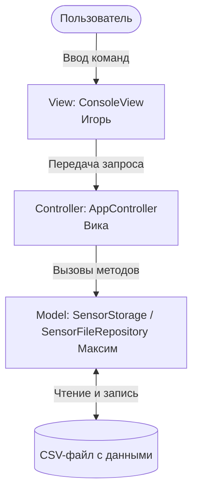

# OSM Sensor Monitor

Консольное Java-приложение для мониторинга и обработки показаний датчиков температуры, газа и CO2.

---

## 👥 Команда и архитектурные роли

Архитектура проекта построена по шаблону **MVC** (Model-View-Controller). Зоны ответственности разделены, что исключает конфликты при слиянии веток в Git.

| Участник | Слой | Пакет | Зона ответственности |
| :--- | :--- | :--- | :--- |
| **Максим** | `Model` / File I/O | `src/ru/miet/osmsensors/model` | Модели датчиков, хранилище в памяти, CSV-файлы |
| **Вика** | `Controller` | `src/ru/miet/osmsensors/controller` | Логика сценариев, валидация пользовательского ввода |
| **Игорь** | `View` | `src/ru/miet/osmsensors/view` | Консольный интерфейс, документация, сборка проекта |

---

## 🏗 Схема взаимодействия

Пользователь работает с консольным интерфейсом, интерфейс передаёт команды в контроллер, контроллер вызывает методы модели, а модель при необходимости работает с файловым хранилищем.

---

## 📂 Детализация модулей

### 🔹 Максим — Model / File I/O

Отвечает за слой данных, бизнес-модель датчиков, хранилище и файловые операции.

**Пакет:** `src/ru/miet/osmsensors/model`

**Файлы:**
- `Sensor.java` — базовый абстрактный класс датчика
- `TemperatureSensor.java` — модель температурного датчика
- `Co2Sensor.java` — модель датчика CO2
- `GasSensor.java` — модель газового датчика
- `SensorRepository.java` — интерфейс репозитория датчиков
- `SensorStorage.java` — хранение датчиков в памяти
- `SensorFileRepository.java` — чтение и запись датчиков в CSV-файл
- `SensorFileFormatException.java` — ошибка неверного формата файла
- `DuplicateSensorException.java` — ошибка дублирования ID
- `SensorNotFoundException.java` — ошибка отсутствия датчика по ID
- `StorageFullException.java` — ошибка переполнения хранилища

**Основные задачи:**
- создание и поддержка моделей датчиков;
- хранение объектов в коллекции;
- поиск, добавление, обновление и удаление датчиков по ID;
- сохранение данных в файл и загрузка из файла.

### 🔹 Вика — Controller / Логика сценариев

Отвечает за управляющую логику: обработку действий пользователя, проверку ввода и вызов методов модели.

**Пакет:** `src/ru/miet/osmsensors/controller`

**Файлы:**
- `AppController.java` — основной контроллер приложения
- `InvalidSensorInputException.java` — ошибка некорректного пользовательского ввода

**Основные задачи:**
- принимать команды от пользователя;
- проверять корректность введённых данных;
- вызывать методы слоя `model`;
- передавать результаты в `view`.

### 🔹 Игорь — View / Интерфейс и сборка

Отвечает за консольный интерфейс, отображение данных, документацию и подготовку проекта к показу или сдаче.

**Пакет:** `src/ru/miet/osmsensors/view`

**Файлы:**
- `ConsoleView.java` — вывод меню, таблиц, сообщений и ошибок в консоль

**Дополнительно:**
- оформление README и сопроводительных материалов;
- помощь с финальной сборкой и проверкой запуска проекта.

### 🔹 Общий файл запуска

**Файл:** `src/ru/miet/osmsensors/Main.java`

> ⚠️ Общая точка входа в программу. Связывает `model`, `controller` и `view`, поэтому изменения в нём вносятся только по согласованию с командой.

---

## 📌 Принципы разделения ответственности

- **Model** не выводит информацию в консоль.
- **View** не изменяет данные напрямую и не содержит бизнес-логику.
- **Controller** связывает `view` и `model`, управляя основным сценарием.
- Каждый участник изменяет в первую очередь свои файлы, а правки общих файлов согласуются заранее.
